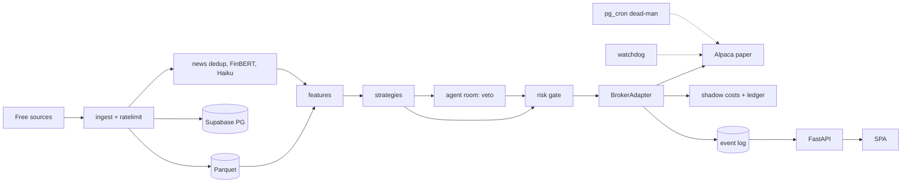

# Kaibot technical design v2 (FINAL)
*10 Nov 2026 · implements 04_prd_v2.md*

## 1. Components

Packages under `src/kaibot/`, with import rules enforced by import-linter:

| Package | Owns | May import |
|---|---|---|
| `common` | injectable clock, rate limiter, settings | — |
| `ingest` | one adapter per source | common, store |
| `features` | point-in-time accessor, regime | common, store |
| `strategies` | dip_reversal, late_day_momentum, shadow ORB, shadow news continuation | features |
| `agents` | the only `anthropic` import, budget gateway, contracts | common, store |
| `risk` | the gate (pure) | common |
| `broker` | `AlpacaPaper`, `SimBroker`, shadow costs, ledger | common |
| `engine` | cycle loop, halts | all |
| `store` | models, Parquet, event log | common |
| `apps/api` | dashboard API | store (read), command writes |

Alt data is unreachable from `features`, except `pump_risk`.

## 2. Data pipeline
Every row carries `event_ts` and `available_ts`. Features read only rows where `available_ts ≤ decision_ts`, through one accessor shared by live trading and replay.

| Source | Cadence and budget | Store | Point-in-time rule |
|---|---|---|---|
| Alpaca IEX websocket (30 hot symbols) | stream | Parquet | receive time |
| Alpaca snapshots and 1-minute bars (about 300 symbols) | 60 s, ≤ 5/min | Parquet | receive time |
| Alpaca SIP bars (volume, β, σ, ADV) | 5 min, ≤ 3/min | Parquet | only `end ≤ now − 15m` |
| Alpaca News websocket | stream | PG | `created_at` + measured p95 lag |
| Clock, calendar, corporate actions | 1/min, daily | PG | adjust at the split date |
| EDGAR 8-K and Form 4 Atom | 30 s, 5 req/s | PG | acceptance time; after 17:30 → next business day |
| EDGAR companyfacts (quality score) | nightly | PG | `filed` date |
| Finnhub (earnings, news, fallback quotes) | ≤ 45/min | PG | ingest time |
| PRN and GNW RSS | 60 s | PG | ingest time |
| Massive grouped daily, Cboe VIX, FRED, BLS, Fed RSS | nightly / 60 s | PG, Parquet | release time |
| Alt data (logged only) | 5–15 min | Parquet `alt/` | ingest time |

- **News:** SHA-1 of the canonical headline plus MinHash (Jaccard ≥ 0.8, 24 h window, same tickers) builds a `news_cluster` with `n_outlets`. FinBERT scores each item; Haiku triages each cluster once.
- **Universe:** rebuilt nightly as of each date, avoiding survivorship bias.
- **Storage:** Postgres holds OLTP data plus 90 days of news. Parquet is partitioned `date/symbol` and queried with DuckDB, with a nightly copy to Cloudflare R2.

## 3. Engine
### One cycle (bar close = t)
| t + | Step | Budget |
|---|---|---|
| 0–2 s | bars and snapshots | 2 s |
| 2–4 s | features, regime (RISK_ON/NEUTRAL/RISK_OFF/CRISIS), FOMC/CPI ±30 min blackout | 2 s |
| 4–5 s | scan → `signal` rows (live and shadow), each with a rules-only veto | 1 s |
| 5 s | dispatch new dip candidates to the room (async); collect verdicts | — |
| 5–6 s | gate on candidates with a live `allow` or `downgrade`, using a fresh quote | 50 ms |
| 6–7 s | submit bracket | 1 s |
| 7–10 s | ledger, shadow marks, events, heartbeat | 3 s |

- Hard budget 20 s; overruns are skipped. A candidate with no verdict after 2 cycles is dropped.

### Agent room
- **Trigger:** a dip_reversal candidate that passed every deterministic filter. SPY momentum never uses the LLM.
- **Input** (ordered so the prefix caches):
  1. System prompt, policy and schemas.
  2. Evidence pack: features JSON, regime, ticker and sector-ETF clusters from the last 24 h, 8-K item codes, macro calendar.
  3. Role instruction.
- **Roles:** Proposer and Critic run in parallel (15 s each), then the Judge (15 s). One round, at most 45 s and about 25k tokens.
- **Schemas:** `ProposerCase`, `CriticCase`, `JudgeVerdict`, forced through tool use.
  - They contain no price, size or stop fields.
  - An evidence ID that isn't in the pack makes the output invalid.
- **Decision:** `admissible()` rejects company-news and unknown causes. `downgrade` means half size. Timeout, invalid output or `veto` means no trade.
- **Routing:** Haiku 5.5 for triage, Sonnet 5.5 for the room, Batch for back-labels.
- **Budget:**
  - Each call reserves `in × p_in + max_tokens × p_out` under a row lock, then settles; worst case is about $0.067 per session.
  - Above $3 a day, the rules-only veto takes over.
  - $150 a month triggers an alert; at $190, no entries.
- **Lookahead:** the room is never replayed. It is judged forward only, against the rules-only shadow.

### Risk gate (pure; hard ceilings in code, profiles only tighten)
- **Rules:**
  - Kill switch, reconciled, market open, entry window 09:35–15:45, data OK, quote ≤ 5 s old.
  - No short, stop on the correct side.
  - Daily loss below the stop.
  - Open risk plus the new max loss ≤ the room left before the daily stop.
  - Position %, position count, entries per day, run drawdown < 4/8/12%.
  - Blackout, `pump_risk`, LULD-halted symbol, duplicate symbol, notional ≤ ledger buying power.
- **Size:** min(risk per trade, position cap, open-risk headroom).

### Brackets
- **Entry:** a marketable limit at ask + 0.05%, TIF day, cancelled after 2 minutes. Stop at 1.5 × ATR₅ₘ, target at min(VWAP, 1.5R).
- **Idempotency:** `client_order_id = kb-{run}-{signal}-{attempt}`. On a duplicate or timeout, GET the order and adopt it.
- **Time exit:** at the horizon, the OCO is replaced by a market exit.
- **SPY momentum:** buy at 15:30, exit MOC (submitted before 15:50).
- **Close:** 15:55 cancel all and close all; 15:58 verify flat.

### Halts
| Trigger | Action |
|---|---|
| 3 consecutive losses | 60-minute pause |
| Quote > 5 s old, or no-news sources down | no entries |
| Ledger drift | halt and alert |
| Daily stop | flatten, halt for the day |
| 3 daily stops in 10 sessions | run paused |

- **Watchdog** (separate process, its own Alpaca client): if the heartbeat is more than 90 s old, it cancels entries and alerts. At 15:55 it flattens.
- **Off-box dead-man:** Supabase `pg_cron` plus `pg_net` at 15:56 ET calls `DELETE /v2/positions` if the heartbeat is stale, using a key held in Vault.

## 4. Data model (Postgres)
- **Runs:** `account` · `run(amount_usd, eur_ref, status, end_reason)` · `segment(run_id, level, from_session)` · `universe_daily`
- **Decisions:**
  - `signal(strategy, mode, symbol, ts, features_hash, entry, stop, target, reasons, rules_veto)`
  - `room_session(signal_id, proposer/critic/judge jsonb, valid, verdict, latency, cost)`
  - `gate_run(signal_id, policy_hash, code_sha, checks jsonb, qty, binding)`
- **Execution:** `order(client_order_id, legs, status)` · `fill(venue_px, shadow_px, fees)` · `ledger(cash, positions, equity_venue, equity_shadow)` · `daily_result(pnl_venue, pnl_shadow, pnl_reported = min, spy_ret, cash_ret)`
- **Ops:** `halt` · `command` · `heartbeat`
- **Evidence:** `filing` · `news_item` · `news_cluster(tickers, first_seen, n_outlets, triage)` · `macro_event`
- **LLM:** `llm_call(model, reserved, actual, cache_read)` · `budget_day`
- **Research:** `trial(strategy, params, code_sha, window, metrics)`
- **Event log:** `event(ts, run_id, type, payload, prev_hash, hash)`, append-only by trigger. P&L is a fold over it.

## 5. API and auth
`/api/v1`. Every POST requires an `Idempotency-Key`.

| Endpoint | Purpose |
|---|---|
| `POST /onboarding` | amount, level, contract acknowledgement; starts at the next open |
| `GET /status` | state, halts, per-source data health, heartbeat, LLM spend |
| `GET /pot`, `/risk`, `/tape?since=` | pot vs SPY and cash; risk strip; fills after costs, with reasons |
| `GET /signals/{id}`, `/evidence` | gate and room transcript; evidence counter |
| `GET /reports/daily/{d}`, `/weekly/{w}`, `/export.csv`, `/gate-report` | reporting (read-only) |
| `POST /controls/pause`, `/resume`, `/flatten-and-stop` | write a `command` row, applied within 1 cycle |
| `POST /runs`, `PUT /runs/current/level` | new run; level applies next session |

- **Polling:** 10 s.
- **Auth:** Supabase magic link (`supabase-js`). The API verifies the JWT via JWKS plus an email allowlist. RLS denies anon access, and the service-role key exists only on the VM.

## 6. Replay and evidence
- **Replay:** Parquet, news and filings are fed in `available_ts` order through the same engine, with an injected clock and `SimBroker` applying shadow costs (bid/ask, 0.25 × spread + 0.5σ√(q/V), 500 ms latency, ≤ 5% of 1-minute volume, limits fill only on a trade-through). CI checks that identical inputs give an identical event-hash chain.
- **Walk-forward:** tune on 12 months (≤ 3 parameters), freeze, test on the next month, roll, starting from 2016.
- **Baselines everywhere:**
  - SPY buy-and-hold.
  - Cash (FRED DTB3).
  - 1,000 random entries with the same count, windows, universe, sizing and exits.
  - Rules-only.
- **Trial log:** the runner refuses to run without inserting a `trial` row.
  - DSR uses the trial count and the variance of trial Sharpes.
  - PBO uses CSCV with 16 partitions.
- **Gate report:** forward paper on frozen code only, against the PRD bar.

## 7. Deployment and operations
- **VM:** Hetzner CX22 (€4–5/month), or Oracle Always Free ARM. Docker Compose runs `worker`, `api`, `watchdog` and `caddy`.
- **Supabase free:** Postgres and Auth. **Frontend:** Cloudflare Pages.
- **Secrets:** `sops` + `age` `.env`. Paper keys only; live keys never touch this box.
- **Observability:** structlog JSON, a healthchecks.io dead-man ping every minute, `/status` as the console, nightly backups to R2.
- **CI:** ruff, mypy, pytest with Hypothesis tests on the gate, and the replay hash check.

| Failure | Detection | Response |
|---|---|---|
| Worker crash | heartbeat > 90 s | broker stops hold; watchdog cancels entries and flattens at 15:55 |
| VM down | healthchecks.io | broker stops; `pg_cron` flattens at 15:56 |
| Supabase down | write error | no entries |
| Stale quotes or 429 | > 5 s, starved bucket | no entries |
| News or EDGAR down | lag > 5 min | no dip entries |
| Room invalid or timeout | validator | no trade |
| LLM budget | gateway | $3/day: rules-only; $190: no entries |
| Ledger drift | per-cycle reconcile | halt |

## 8. Stack
- **Python 3.13:**
  - fastapi ≥ 0.115, pydantic ≥ 2.8, sqlalchemy ≥ 2.0, psycopg ≥ 3.2, apscheduler 3.10, pandas ≥ 2.2, anthropic ≥ 0.40
  - transformers ≥ 4.44 and torch ≥ 2.4 CPU (FinBERT; non-commercial licence)
  - **to add:** pyarrow ≥ 17, duckdb ≥ 1.1, datasketch ≥ 1.6, import-linter ≥ 2.1
- **Frontend:** Node 22, Vite 6, React 19, TypeScript 5.6, Tailwind 4, TanStack Query 5, supabase-js 2.

### Repo fixes required
1. **`profiles.yaml`:** one universe; max position 10/15/20%; ORB shadow-only; add entries per day and run drawdown.
2. **`gate.py`:** `max_quote_age_s` = 5; add the missing rules from §3.
3. **`base.py`:** update the `client_order_id` comment.
4. **`pyproject.toml`:** create `apps/api`.
5. **EDGAR poll:** 30 s.
