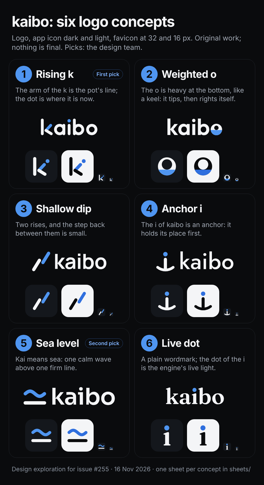

# kaibo logo exploration

Issue #255, 16 Nov 2026. Six original logo concepts for kaibo, for the stakeholder to choose from. Nothing in the app
changes here.

**Chosen: concept 1, Rising k (stakeholder, 16 Nov 2026).** The app draws it from copies of its files in
`apps/web/src/brand/logo/`.

| Read | What it is |
|---|---|
| [`logo_concepts.md`](logo_concepts.md) | The six concepts, the recommendation, the lookalike check, motion, colours, fonts and files |
| [`logo_research.md`](logo_research.md) | What makes well-known marks work, and what that means for kaibo |
| [`name_check.md`](name_check.md) | Who else is called Kaibo: facts and links, no legal conclusions |

Proof sheets, one per concept: [`sheets/`](sheets/). SVG files: [`concepts/`](concepts/). Scripts: [`gen/`](gen/).
