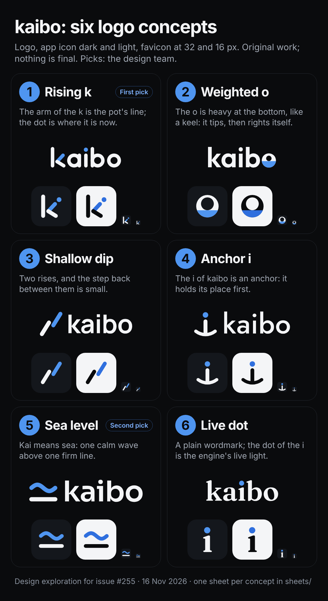
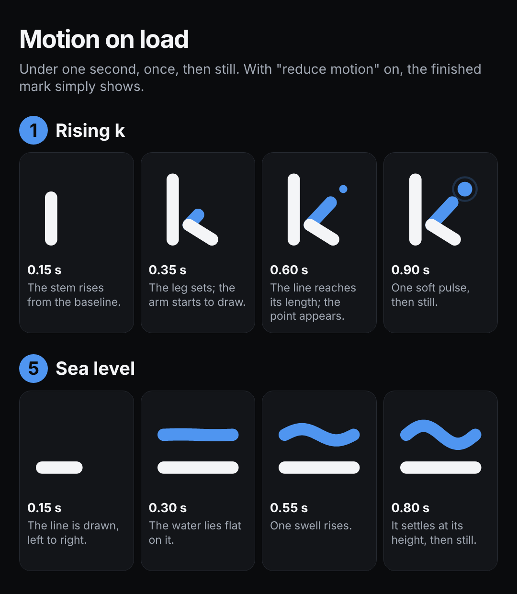

# kaibo logo: six concepts

Issue #255 · 16 Nov 2026 · Design. **Status: exploration.** Nothing here is final and nothing in the app changes. The
stakeholder picks (through Product); Frontend then swaps the logo in through the one `Logo` component of #254.

The research behind the choices is in [`logo_research.md`](logo_research.md). The name check is in
[`name_check.md`](name_check.md).



## The six, in one line each

| # | Name | The idea | What leads | Wordmark |
|---|---|---|---|---|
| 1 | **Rising k** | The arm of the k is the pot's line; the dot is where it is now. | A letter symbol and its own wordmark | Drawn for kaibo, no font |
| 2 | **Weighted o** | The o is heavy at the bottom, like a keel: it tips, then rights itself. | The wordmark; the o is the symbol | Outfit SemiBold, o redrawn |
| 3 | **Shallow dip** | Two rises, and the step back between them is small. | An abstract symbol | Manrope Bold |
| 4 | **Anchor i** | The i of kaibo is an anchor: it holds its place first. | A picture symbol made from a letter | Jost Medium |
| 5 | **Sea level** | Kai means sea: one calm wave above one firm line. | An abstract symbol | Sora SemiBold |
| 6 | **Live dot** | A plain wordmark; the dot of the i is the engine's live light. | The wordmark alone | Fraunces SemiBold, dot redrawn |

All six are original work for kaibo. Symbols and wordmarks can be mixed: for example the symbol of 5 with the wordmark
of 1.

## My recommendation

**First: 1, Rising k. Second: 5, Sea level.** If warmth matters more than a symbol, 2 (Weighted o) is the third.

### Why 1, Rising k

- **It is made of the app's own signs.** On Home the pot's line is blue and ends in a point. The k's arm is that line
  and that point. Nobody else has this, because it comes from our screen.
- **It is the initial.** A k is what people look for on a home screen under "kaibo". It holds at 16 px with 2 px strokes.
- **The wordmark is ours.** All five letters are drawn from one stem and one circle. No font, so no licence to track,
  and no other brand set in the same type.
- **It works in one colour** and its motion is obvious: the line draws, the point arrives.
- **Its risks:** several finance brands lead with a K, so it will be compared. A line going up can be read as a
  promise; this one is short and ends in a point, not an arrow, and the words must never add "up".

### Why 5, Sea level

- **It says the honest thing.** A wave over a straight line is the maths sign ≃, read as "about equal" (its formal
  name is "asymptotically equal to"). kaibo aims for about the market's return, with a floor of limits under it. It is
  level, not rising, so it promises nothing.
- **It fits the name.** *Kai* is the sea in Hawaiian and in one Japanese reading; *kaibō* (海防) is coastal defence.
  A calm sea above a firm line is the name drawn.
- **It is the calmest of the six**, and the least like the bulls, rockets and candlesticks of the field.
- **Its risks:** wave marks exist in finance, and the sign itself is public, so it is harder to own than a drawn
  letter. It needs the word next to it until people know it.

### Why not the others first

- **2, Weighted o:** the most charming wordmark, and the rocking o is a lovely piece of motion. But its other letters
  come from a font anyone may use, the icon is a ring among many rings, and in one colour most of the idea goes.
- **4, Anchor i:** clear and friendly, but an anchor is a common picture, and "Anchor" was the name of a crypto
  savings product that collapsed in 2022.
- **6, Live dot:** elegant and cheap to build. As an icon it is a lone i, which reads as "information".
- **3, Shallow dip:** the idea is right for the product, but the picture is the most generic, and a slash in a square
  is a well-known bank's mark.

## The concepts

Each has a proof sheet: the logo, its parts, one colour, light background, the v4 phone header at 390 × 57 px, the app
icon at 180 and 60 px, and the favicon at 32 and 16 px with its real pixels enlarged.

### 1. Rising k

*The arm of the k is the pot's line; the dot is where it is now.*

- **What you see.** A lowercase k. Its stem and leg are white; its arm is a blue line. In the wordmark the blue dot
  sits on the i. When the k stands alone, as an icon, it carries the dot with it, on the arm's own line.
- **Built from.** One stem 15 wide and 88 tall, one circle 60 across, and one chevron that stands 4.5 off the stem.
  The other letters use the same stem and circle.
- **Strong:** one idea from our own screen; legible at 16 px; works in one colour; own letters.
- **Weak:** a K among other Ks; a dot beside a k can read as a small figure throwing a ball.
- **Sheet:** [`sheets/concept-1-rising-k.png`](sheets/concept-1-rising-k.png) · **Files:** `concepts/1-rising-k/`

### 2. Weighted o

*The o is heavy at the bottom, like a keel: it tips, then rights itself.*

- **What you see.** The word kaibo. The hole of the last o sits high, so the ring is thin on top and thick below. The
  thick part under the hole is blue: the ballast. Alone, the o is the icon.
- **Built from.** Two circles and one cut. In the wordmark the ring is 0.62 of a stem wide at the top and 1.75 at the
  bottom.
- **Why it fits.** A boat with a heavy keel leans in a gust and comes back. That is "smaller falls" without a chart.
- **Strong:** warm; a real idea in one letter; the best motion of the six (the o rocks and settles).
- **Weak:** in one colour only the off-centre hole is left; ring marks are common; the other four letters are a font.
- **Sheet:** [`sheets/concept-2-weighted-o.png`](sheets/concept-2-weighted-o.png) · **Files:** `concepts/2-weighted-o/`

### 3. Shallow dip

*Two rises, and the step back between them is small.*

- **What you see.** Two equal strokes rising at the same angle. The second, in blue, starts a little lower than the
  first ended.
- **Built from.** Two strokes 15 wide. The step back is 10 on a rise of 42: about a quarter.
- **Why it fits.** It is the product's goal as a picture: keep climbing, fall back less.
- **Strong:** very simple; works in one colour.
- **Weak:** the most generic picture here; at 16 px the two strokes run together and the idea is gone; it shows two
  rises, which leans towards a promise; needs explaining.
- **Sheet:** [`sheets/concept-3-shallow-dip.png`](sheets/concept-3-shallow-dip.png) · **Files:** `concepts/3-shallow-dip/`

### 4. Anchor i

*The i of kaibo is an anchor: it holds its place first.*

- **What you see.** The middle letter of the name, an i, with one shallow arc at its foot. Dot, stem, arc: an anchor.
- **Built from.** A dot, a stem 14 wide and an arc 12 wide. No crossbar, no flukes, no ring.
- **Why it fits.** kaibo protects first: stops held at the broker, a daily loss limit, a safety net.
- **Strong:** read at once by anyone; friendly; legible at 16 px; works in one colour.
- **Weak:** anchors are everywhere in sea-themed branding; the 2022 "Anchor" collapse; "anchored" can also mean stuck.
- **Sheet:** [`sheets/concept-4-anchor-i.png`](sheets/concept-4-anchor-i.png) · **Files:** `concepts/4-anchor-i/`

### 5. Sea level

*Kai means sea: one calm wave above one firm line.*

- **What you see.** One blue wave above one white bar of the same weight and length.
- **Built from.** One period of a sine wave (84 long, rising and falling 11 from its middle) and one straight stroke,
  both 15 wide.
- **Why it fits.** Three readings, all true to the product: the sea of the name; a line of limits under the pot; and
  the sign ≃, "about equal", which is what kaibo aims to be to the market.
- **Strong:** calm; honest; unlike the field; legible at 16 px; works in one colour.
- **Weak:** the sign is public and wave marks exist, so it is harder to own; without the word it could be a
  swimming pool or a maths app.
- **Sheet:** [`sheets/concept-5-sea-level.png`](sheets/concept-5-sea-level.png) · **Files:** `concepts/5-sea-level/`

### 6. Live dot

*A plain wordmark; the dot of the i is the engine's live light.*

- **What you see.** kaibo in a soft serif. The dot of the i is a round blue point.
- **Built from.** Set type with one redrawn dot.
- **Why it fits.** The header already has one live light for the engine. The name carries the same light. A serif is
  rare in this field, which sets it apart; Robinhood uses one for headlines
  ([source](https://www.portorocha.com/robinhood)).
- **Strong:** calm and grown-up; the cheapest to build; nothing to explain.
- **Weak:** in one colour there is no idea left; a coloured dot on an i is a common device; the icon is a lone i.
- **Sheet:** [`sheets/concept-6-live-dot.png`](sheets/concept-6-live-dot.png) · **Files:** `concepts/6-live-dot/`

## Against the eight principles

✓ strong · ~ partly · ✗ weak. My own judgement, from the proof sheets.

| Principle | 1 Rising k | 2 Weighted o | 3 Shallow dip | 4 Anchor i | 5 Sea level | 6 Live dot |
|---|---|---|---|---|---|---|
| One idea | ✓ | ✓ | ✓ | ✓ | ✓ | ✓ |
| A distinct silhouette | ✓ | ~ a ring | ~ two strokes | ~ clear but common | ✓ | ✗ a word |
| Simple construction | ✓ 4 parts | ✓ 2 parts | ✓ 2 parts | ✓ 3 parts | ✓ 2 parts | ~ set type |
| Legible at 16 px (thinnest stroke) | ✓ 2.0 px | ~ 1.2 px at the top | ~ 2.0 px, but the two strokes run together | ✓ 1.7 px | ✓ 1.9 px | ~ reads as "i" |
| Works in one colour | ✓ | ~ | ✓ | ✓ | ✓ | ✗ |
| An ownable colour | ~ | ~ | ~ | ~ | ~ | ~ |
| Symbol and wordmark work apart | ✓ | ✓ | ~ | ✓ | ~ | ✗ |
| Motion potential | ✓ | ✓ | ~ | ~ | ✓ | ✓ |
| Promises nothing | ~ | ✓ | ~ | ✓ | ✓ | ✓ |

The colour row is the same for all six: the blue is the app's own, but blue is common in finance, so it is shared
rather than owned.

## Lookalike check

For each concept: the nearest marks I know of, why this is not one of them, and what is left to worry about. This is
knowledge and reading, not a register or image search. That search has to be done before anything is used in public.

| # | Could be confused with | Why it is not a lookalike | What remains | Verdict |
|---|---|---|---|---|
| 1 | Other K marks in finance. Klarna's app icon is a single capital K on pink, and its wordmark ended in a full stop from 2017 to 2024 ([source](https://www.designyourway.net/blog/klarna-logo/)). Kraken, KuCoin and Kalshi also start with K. | Lowercase with a tall stem; the arm and leg are a chevron that stands off the stem; the arm is a second colour; the point sits on the arm's line, high, not on the baseline; blue on near-black. | Any K will be compared with other Ks. | Keep |
| 2 | Ring and circle marks in general. Coinbase's symbol is described as between a C and a circle ([source](https://www.itsnicethat.com/news/moniker-coinbase-rebrand-graphic-design-250322)). | The ring is closed; its hole is off-centre; the base is a filled blue bowl. | Rings are many. Some will see an eye or a porthole. | Keep |
| 3 | Deutsche Bank's slash in a square ([source](https://www.db.com/news/detail/20240422-slash-in-a-square-deutsche-bank-logo-turns-50?language_id=1)). The double slash of code. Slanted stripes in sportswear. | Two strokes, not one; round ends; staggered; no frame. | In an app icon the square comes back, and the two are in the same trade. The closest call of the six. | Keep, as the weakest |
| 4 | Anchor pictures in general. The name Anchor: a lending product on Terra that paid about 19.5% and failed in May 2022 ([source](https://thedefiant.io/education/blockchains/what-was-terra)). | Three parts, made from the name's own i; no crossbar, flukes or ring. | The association with that failure, for people who followed crypto. | Keep, flagged |
| 5 | Wave marks in finance: Calibra's tilde in a circle, which in 2019 was said to look like Current's mark ([source](https://thevergetoday.pages.dev/2019/6/20/18692621/facebook-calibra-current-bank-logo-similarity)); Solitone's two wave fragments ([source](https://abduzeedo.com/node/88813)). Equals, whose symbol is two ovals like an equals sign ([source](https://logos-world.net/equals-unveils-new-logo-and-brand-identity/)). The maths sign itself. | One wave over one straight bar, no circle, two colours. None of those pairs a wave with a bar. | It sits between the wave marks and the equals sign. A public sign is hard to own. | Keep |
| 6 | Any wordmark with a coloured dot on its i. | Nothing sets it apart but the typeface and the blue. | Low distinctiveness. | Keep, as the plain option |

### Dropped on the way

Drawn or considered, then dropped. Kept here so nobody has to try them again.

| Idea | Why it was dropped |
|---|---|
| A ball resting in a bowl (it rolls back to the bottom) | Read as a figure with raised arms; also the shape of an Arabic letter. |
| A keel: a light, a waterline, a half disc below | Read as a pot with a lid. |
| A harbour: an open ring around a dot | Too close to the many ring-and-dot signs (target, record, power). |
| A ship's load line: a circle with a bar through it | The same structure as a famous transport roundel. Dropped before drawing. |
| An i standing in a wave (a buoy) | Read as a cross. |
| Three rising strokes | Read as signal bars; too near three-stripe marks. |
| A curved rising stroke with one dip | A curved tick; too near a famous sports mark. |
| A k whose arm reaches full height | Read as a capital K; less ours. |
| A k drawn from quarter circles | Legible, but weaker than concept 1, whose wordmark keeps the "one stem, one circle" idea. |
| "kai" stacked over "bo" in a square | Unreadable below 60 px. |
| Steps with scooped treads | Generic stairs. |

## Motion

For the two recommended concepts. Under one second, once, then still. Position and opacity only, as the v4 motion
rules ask. With "reduce motion" on, nothing moves and the finished mark simply shows.



| | 1 Rising k | 5 Sea level |
|---|---|---|
| **On load** | The stem rises (0.2 s). The leg sets. The blue arm draws out from the stem (0.3 s). The point appears at the end of the line and gives one soft pulse. | The white line is drawn from left to right (0.26 s). The blue stroke lies flat on it, then rises into one swell and settles (0.5 s). |
| **In the header** | The same, on the wordmark: the arm draws, then the dot lands on the i. | The same, at header size. |
| **After that** | Still. The engine's light in the header is the only thing that pulses. | Still. |
| **Reduce motion** | The finished mark, at once. No pulse. | The finished mark, at once. |

A working sketch is in [`motion/motion_demo.html`](motion/motion_demo.html) (open it in a browser). It was checked both
ways: it ends on the finished mark, and with "reduce motion" on it never moves.

One line for the others: **2** the o rocks to one side and back, twice, smaller each time, and settles; **3** the first
stroke draws, the second starts lower and draws; **4** the dot blinks once, like a harbour light; **6** the dot fades
in last.

## Colour

| Name | Value | Used for | Contrast |
|---|---|---|---|
| Night | `#0A0B0D` | The app's background; the mark on light backgrounds | |
| Paper | `#F4F5F7` | The mark on dark backgrounds; the light icon | 18.05:1 on Night |
| Sea | `#4F95F0` | The accent on dark backgrounds (the app's `--sea`) | 6.46:1 on Night |
| Deep sea | `#2F6FDE` | The accent on light backgrounds | 4.33:1 on Paper |
| Icon night | `#14171C` | The dark app icon's tile | |

Sea on Paper is only 2.79:1, which is why light backgrounds use Deep sea. White on Deep sea is 4.72:1.

Green, red, amber and violet are not used: in the app they mean gain, loss, paper and the agent.

## Wordmarks, fonts and licences

Every wordmark is outlined: the files hold shapes, not text, so nothing depends on a font being installed.

| # | Letters | Licence | Copyright line in the font |
|---|---|---|---|
| 1 | Drawn for kaibo in `gen/build.py` from one stem and one circle | Ours | |
| 2 | Outfit SemiBold, version 1.100; the o is redrawn | SIL Open Font License 1.1 | 2021 The Outfit Project Authors |
| 3 | Manrope Bold, version 4.504 | SIL Open Font License 1.1 | 2019 The Manrope Project Authors |
| 4 | Jost Medium, version 3.710 | SIL Open Font License 1.1 | 2020 The Jost Project Authors |
| 5 | Sora SemiBold, version 2.000 | SIL Open Font License 1.1 | 2019 The Sora Project Authors |
| 6 | Fraunces SemiBold, version 1.000; the dot of the i is redrawn | SIL Open Font License 1.1 | 2020 The Fraunces Project Authors |

- The fonts came from the `@fontsource` packages on npm (version 5.3.0 of each), which carry the licence text.
- The licence says its terms do not apply to a document made with the fonts, so a logo outlined from them is free to
  use. The font files themselves are not in this repository.
- No proprietary font is used anywhere. The captions on the sheets are set in Inter, as the app is.

## Files

Each folder under `concepts/` holds the same eleven SVG files:

| File | What it is |
|---|---|
| `symbol-on-dark.svg`, `symbol-on-light.svg` | The symbol in two colours, for dark and for light backgrounds |
| `wordmark-on-dark.svg`, `wordmark-on-light.svg` | The lowercase wordmark |
| `lockup-on-dark.svg`, `lockup-on-light.svg` | The horizontal lockup. For 1, 2 and 6 the wordmark is the lockup |
| `symbol-mono.svg`, `lockup-mono.svg` | One colour. They use `currentColor`, so they take the colour of the text around them (black when opened alone) |
| `icon-dark.svg`, `icon-light.svg` | The app icon: a rounded square, 512 units, the symbol centred |
| `favicon.svg` | The same on a smaller tile with a larger symbol, for 16 and 32 px |

The "on dark" files have light shapes on a clear background, so they look empty on a white page. The sheets show them
as intended.

Other files: `logo_concepts.png` (the contact sheet), `sheets/` (one sheet per concept and the motion storyboard),
`motion/motion_demo.html`, and `gen/` (the scripts).

## Rebuild

```
cp docs/design/logo/gen/fonts.example.json docs/design/logo/gen/fonts.json    # then point it at your font files
python docs/design/logo/gen/build.py     # the 66 SVG files
python docs/design/logo/gen/sheets.py    # the contact sheet and the six proof sheets (needs Playwright, Pillow, Inter)
python docs/design/logo/gen/motion.py    # the motion sketch and its storyboard
```

`gen/geo.py` draws every shape as an outline. `gen/fontpaths.py` turns font letters into outlines with the font's own
kerning. Nothing here is imported by the app or is part of any build.

## For Frontend, once one is picked

- #254 prepares one `Logo` component and one SVG source. The picked concept's `symbol-on-dark.svg` and
  `wordmark-on-dark.svg` are that source; `favicon.svg`, `icon-dark.svg` and `icon-light.svg` feed the tab and the
  home-screen icons.
- For 1, 2 and 6 the header shows the wordmark alone. For 3, 4 and 5 it shows symbol and wordmark.
- In the icons the symbol fills 56 to 62 percent of the tile, inside the safe area that phones crop to.
- The motion is a separate small story after the swap.

## Limits

- **No trademark or image search.** The lookalike check is from knowledge and reading.
- **Not tried on a real phone**, in Safari, or on a home screen. The sheets are drawn in Chromium.
- **One blue.** No other hue was explored, because the app's other colours are taken.
- **The pick is the stakeholder's.** After it, the chosen concept deserves a second pass on spacing and small sizes.
