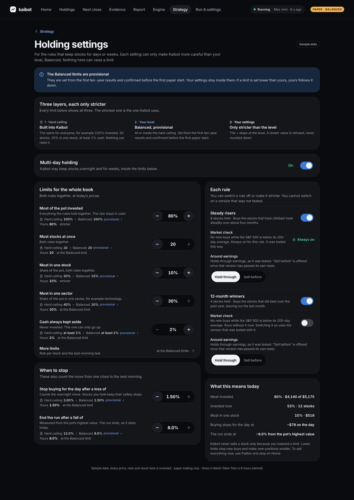
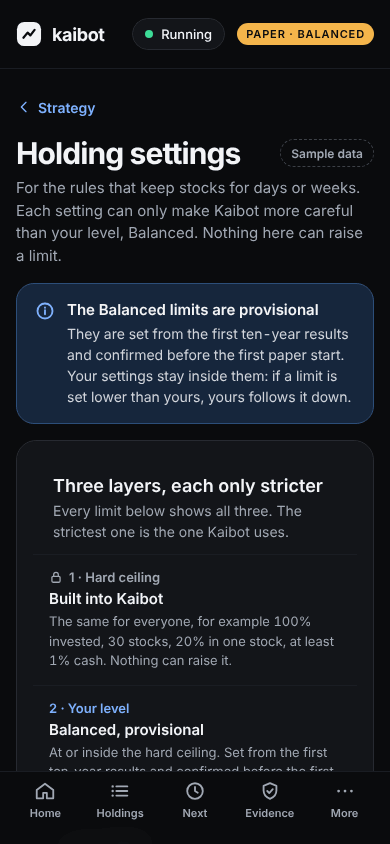
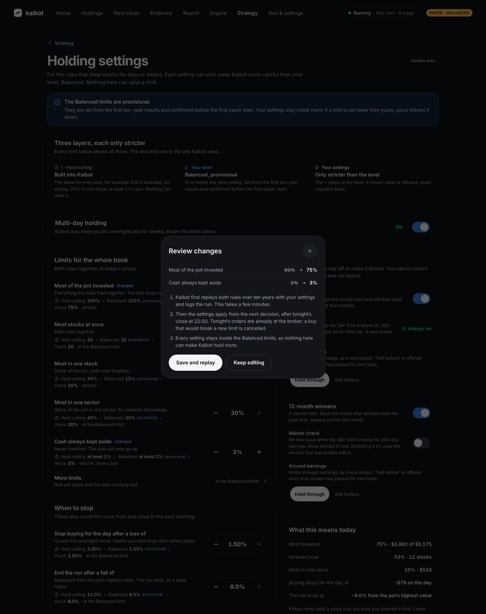
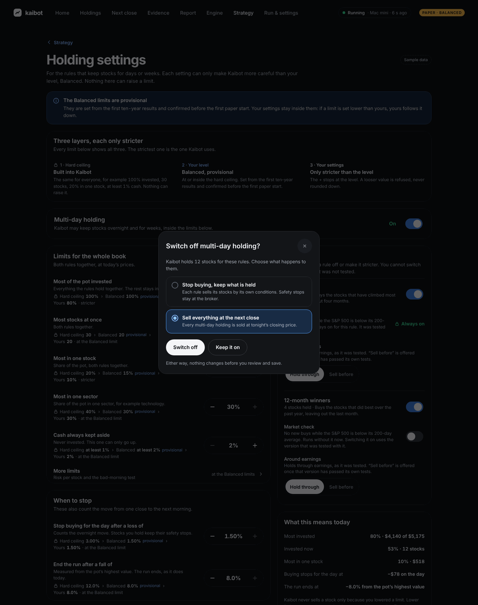
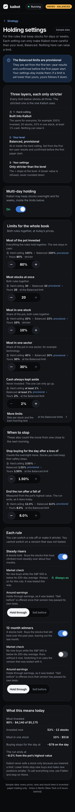

# M7 Holding settings: the owner's tighten-only settings for a multi-day book

Date: 2026-11-12. Issue #132 (S92), the design part. Status: **proposal, awaiting stakeholder approval**. Frontend builds nothing before that.

Product owns the rest of #132: the decision note on which settings exist, and the level limits for multi-day books.
The stakeholder confirms those limits with the first paper start (decision 15, section 6). This design does not set them.
It shows today's **provisional** values and lets the owner only tighten them.

Nothing was published. The boards are files in this folder, and `canvas.json` lists them with a note. Product publishes them to the design canvas after review, as with #129.

## 1. The boards

| Canvas | File in `v3/project/v3/` | What it shows |
|---|---|---|
| 16 | `HoldingSettings.dc.html` | One page, reached from Strategy. A banner says the Balanced limits are provisional. A card "Three layers, each only stricter" explains hard ceiling → level → your settings, and every limit row shows all three ("Hard ceiling 100% › Balanced 100% provisional › Yours 80%"). Below it: the multi-day holding switch; "Limits for the whole book" (with "More limits" folded); "When to stop"; "Each rule" (switch a rule off, its market check, around earnings); "What this means today" in dollars. A dock appears for unsaved changes. Two sheets: Review and "Switch off multi-day holding?". |
| 16m | `HoldingSettingsMobile.dc.html` | The same page in one column. Steppers sit under their label. The sheets rise from the bottom and cover the tab bar. |

Board props (section "States"): `showLoading` (skeleton), `notStartedYet` (today's real state: multi-day holding is off at every level, `all_levels.allow_overnight: false`), `earningsTested` (the "Sell before earnings" choice is open).

| Desktop | Phone, first screen |
|---|---|
|  |  |
|  |  |

Whole phone page: 

## 2. The settings and what "tighten-only" means for each

Three layers, each only stricter than the one before; the strictest wins:
1. **Hard ceiling**, `BOOK_HARD_CEILINGS` in `src/kaibot/risk/gate.py` (100% invested, 30 stocks, 20% per stock, 40% per sector, at least 1% cash, 0.25% ATR risk, 15% gap loss; daily stop 3% and run end 12% from `HARD_CEILINGS`). The same for everyone; nothing on this screen raises it.
2. **Level value**, `multi_day.levels.<level>` in `config/profiles.yaml`, marked `provisional: true` (placeholders until the stakeholder confirms them).
3. **Owner setting**, only stricter. `tighten_book` refuses (ValueError) anything looser, unknown or of the wrong type; it never clamps. The screen therefore never offers a looser value.

The sample owner keeps 80% invested and 10% per stock, the same sample limits as the approved dashboard boards 11 to 15 (`m7_data.LIMIT_INVESTED`, `m7_data.LIMIT_STOCK`), so the numbers match across the canvas.

The level values are the Balanced ones in `config/profiles.yaml` (`multi_day.levels.balanced` and `levels.balanced`), all marked provisional. The hard ceilings are in `src/kaibot/risk/gate.py`. Neither file is changed by this story.

| On the screen | Engine field | Balanced (provisional) | Hard ceiling | The owner may |
|---|---|---|---|---|
| Multi-day holding | `all_levels.allow_overnight` | off today (on in the sample) | n/a | switch it off; switch it back on only up to what the level allows |
| Most of the pot invested | `max_gross_pct` **and** `max_overnight_pct` | 100% (sample owner: 80%) | 100% | lower it, in steps of 5 |
| Most stocks at once | `max_names` | 20 | 30 | lower it |
| Most in one stock | `max_name_pct` | 15% (sample owner: 10%) | 20% | lower it |
| Most in one sector | `max_sector_pct` | 30% | 40% | lower it |
| Cash always kept aside | `min_cash_pct` (a floor) | 2% | at least 1% | **raise** it |
| More limits · Risk per stock | `atr_risk_pct` | 0.10% | 0.25% | lower it (smaller positions) |
| More limits · Loss on a bad morning | `max_gap_loss_pct` | 12% | 15% | lower it |
| Stop buying for the day after a loss of | `daily_stop_pct` | 1.5% | 3% (`HARD_CEILINGS.max_daily_loss_pct`) | lower it |
| End the run after a fall of | `run_drawdown_end_pct` | 8% | 12% (`HARD_CEILINGS.run_drawdown_end_pct`) | lower it |
| Each rule: on | the rule's toggle | on | n/a | switch it off; on again only if it was on |
| Each rule: market check | pre-declared version with or without the SPY 200-day filter | Steady risers: always on, shown locked with no switch (its pre-registration has the filter built in). 12-month winners: the sample runs `nofilter` | n/a | switch it on where a tested version has it; never off where the rule was tested with it |
| Each rule: around earnings | "hold through" (base) or "exit before" | hold through | n/a | choose "Sell before" only once that version has passed its own tests |

How the screen enforces it:
- The **+** on a cap stops at the level value. The **−** on the cash floor stops at the level value. The disabled button is shown, not hidden, and the row says "Balanced limit 100% · provisional" or "yours is lower".
- No field takes typed numbers, so the screen has no "too high" error to show.
- One "Most invested" control sets both gross and overnight exposure. With only multi-day rules trading they are the same number, and two controls would confuse. Intraday rules are retired (decision 15).
- If the stakeholder later sets a level limit **below** an owner's value, the owner's value follows it down. The banner says so. `tighten_book` already refuses a looser value, so the backend has to clamp an owner's value when the level changes, or Product writes that down (see section 4).

## 3. What a change does

- **Lowering a limit never sells.** It stops new buys and makes new positions smaller. Example warnings: holding 12 stocks with the most set to 11, or Walmart above a new per-stock cap. Selling everything stays with "Flatten and stop" on Home.
- **Switching multi-day holding off** opens a sheet with two choices: "Stop buying, keep what is held" (the default) or "Sell everything at the next close". Switching off a single rule means its stocks are kept until the rule sells them.
- **Saving** shows "Saved · replay running". CLAUDE.md requires every parameter change to run a replay that logs a `trial` row, so the review sheet says: "Kaibot first replays both rules over ten years with your settings and logs the run". The settings then apply from the next decision, after tonight's close. A buy already at the broker for tonight that would break a new limit is cancelled.

## 4. Open questions for Product and the stakeholder

The five for the stakeholder (also in the PR):
- **A. Level limits for multi-day books** (exposure cap, number of stocks, per-stock cap, run-drawdown end per level). Today's values are placeholders.
- **B. Run-drawdown hard ceiling.** It is 12% in `HARD_CEILINGS`. If rule 1's ten-year worst fall is deeper, a level cannot be set above 12%; raising the 12% loosens a hard ceiling, which only the stakeholder can approve.
- **C. Switching multi-day holding off:** hold until each rule sells (drawn as the default) or sell everything at the next close? The sheet offers both.
- **D. A limit set below current holdings:** stop buying until under the limit (drawn), or trim to the limit?
- **E. "Sell before earnings":** offer it only for rule versions that passed their own tests (drawn: closed until then)?

Notes for Product:

1. **Level limits** (stakeholder, decision 15 section 6): the exposure cap and the run-drawdown end per level. The screen works with any values; it reads them and marks them provisional until confirmed.
2. **Lowering below what is held**: no forced sales; buys stop until the book is under the new limit. This is proposed, not decided.
3. **Switching off: keep or sell.** Two choices are proposed. Product may decide on one.
4. **Tonight's orders after a save**: is a buy at the broker that breaks a new limit cancelled (as drawn), or does the change wait one more close?
5. **Earnings and market-check choices** are versions of a rule, not just limits. "Exit before earnings" is an approximate variant in both pre-registrations, with no Gate B verdict of its own, so the screen keeps it closed (`earningsTested=false`). Switching the market check on for 12-month winners moves to the other pre-declared version. Should that be offered only once that version has passed Gate B?
6. **Trial count**: each owner save logs a replay trial. That raises the deflated-Sharpe bar for every trial. Should owner replays be logged separately?
7. **Level clamp**: when a level limit drops below an owner's value, clamp the stored value, or refuse the level change until owners are updated?

## 5. Data the screen needs (for the contract Backend-quant writes)

For each setting: the level value, whether it is provisional, the owner's value, and the hard ceiling. These come from `profiles.yaml` and `gate.py`, and the owner's values are stored with the config. The screen also needs, for each rule, which versions exist and whether each has passed (for the market check and earnings choices), plus the counts it already gets for #129: stocks held, invested %, and the largest share. A save returns the replay job's state, as the M5 config replay queue does.

## 6. Checks

Run `python3 preview.py --shots shots_m7.json --only 16 --check`. It takes 16 pictures: both boards, after clicks (stepper down, More limits, market check, Review, Save, Switch off), each prop state, and widths of 320, 800 and 1024 px. Result: **0 findings**.
- Every target on the phone is at least 44 px.
- No sideways scroll at 320 px.
- The lowest text contrast is 5.36:1 (a disabled earnings choice, #7E8693 on #0A0B0D).

Accessibility, built in:
- Each stepper is a labelled group with "Lower: …" / "Raise: …" buttons and a live `output`.
- The switches are `role="switch"`, and the master switch also says On or Off in words.
- Earnings is a radio group.
- The sheets are modal dialogs.
- Warnings carry an icon and words.

Not checked yet: a real screen reader, and the boards in the real canvas viewer.

Board 16 needs stakeholder approval (through Product) before Frontend builds it.

Rebuild: `python3 multiday.py`, or `python3 m7_settings.py` for these two boards only. The other M7 boards come out byte-identical.
