# M7 dashboard for a multi-day book: boards, data check and accessibility pass

Date: 2026-11-12. Issue #129 (S89). Status: **proposal, awaiting stakeholder approval**. Frontend builds nothing before that (S90).

Read first: the research in `research_m7_multiday_dashboard.md` and the layout debate in `../debate/m7_multiday_dashboard.md`. This note describes what was drawn, checks it against what Engine v3 will know, and records the accessibility pass.

Nothing was published. The boards are files in this folder; Product publishes them to the design canvas after review (`canvas.json` already lists them, with notes).

## 1. The boards

All twelve use the v3 shell, tokens and motion unchanged. Desktop boards are 1440 px wide, phone boards 390 by 844.

| Canvas | File in `v3/project/v3/` | What it shows |
|---|---|---|
| 11 | `Overview.dc.html` | Home. Engine state as one headline over four checks; the pot at today's prices; since the start, today (with the overnight part) and the S&P 500 from the same start; one chart with both lines; how much is invested, with the limit and the market check; what happens at the next close; how many stocks are held; Controls with "Flatten and stop" where it is today. |
| 11m | `OverviewMobile.dc.html` | The same on a phone. The first screen carries all five answers; the chart is one swipe down. |
| 12 | `Holdings.dc.html` | Stocks held, grouped by rule, with filter chips and a sort. Per stock: days held, share of the pot, gain or loss, how far it is from its rule's sell conditions, the safety stop at the broker, and a tag if something happens to it tonight. A "Sold" tab lists closed holdings with the reason. |
| 12m | `HoldingsMobile.dc.html` | Two lines per stock; a row opens in place for the sell conditions and the stop. |
| 12b | `Holding.dc.html` | One holding (sample: Walmart): why it was bought, what would make Kaibot sell it, where the price is between the stop and now, what happens next, key numbers, history. |
| 12bm | `HoldingMobile.dc.html` | The same, with "why it was bought" first. |
| 13 | `NextClose.dc.html` | When the next close is; the plan for it (selling, buying, resizing, not buying) with one sentence of reason per order; what happened at the last close; the last trades; what comes up. |
| 13m | `NextCloseMobile.dc.html` | The same in one column. |
| 14 | `Evidence.dc.html` | The four gates in plain words; for each rule on paper, four steps A to D with an icon and a word, one sentence on what is next and "Show the checks"; rules that are not trading. |
| 14m | `EvidenceMobile.dc.html` | The same in one column. |
| 15 | `MultidayStates.dc.html` | A sheet: loading, empty, buying stopped and problems, each at full desktop width with a caption. |
| 15m | `MultidayStatesMobile.dc.html` | A sheet: the first phone screen of eight states. |

### Pictures

Made with `preview.py` (section 3). They are a local check, not the canvas.

| Desktop | Phone, first screen |
|---|---|
| 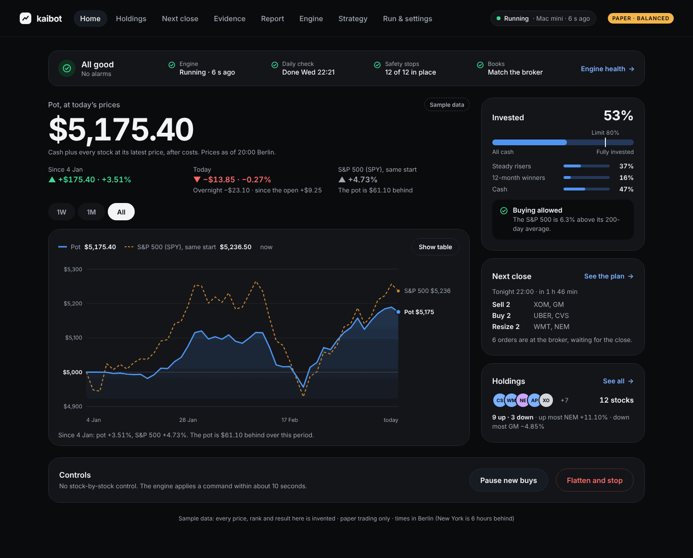 | 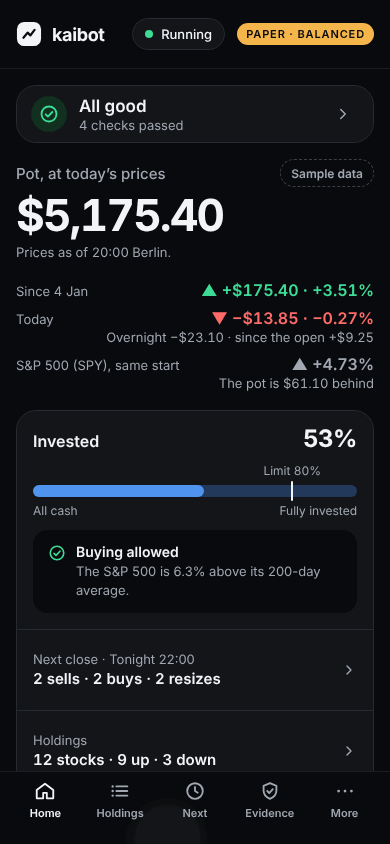 |
| 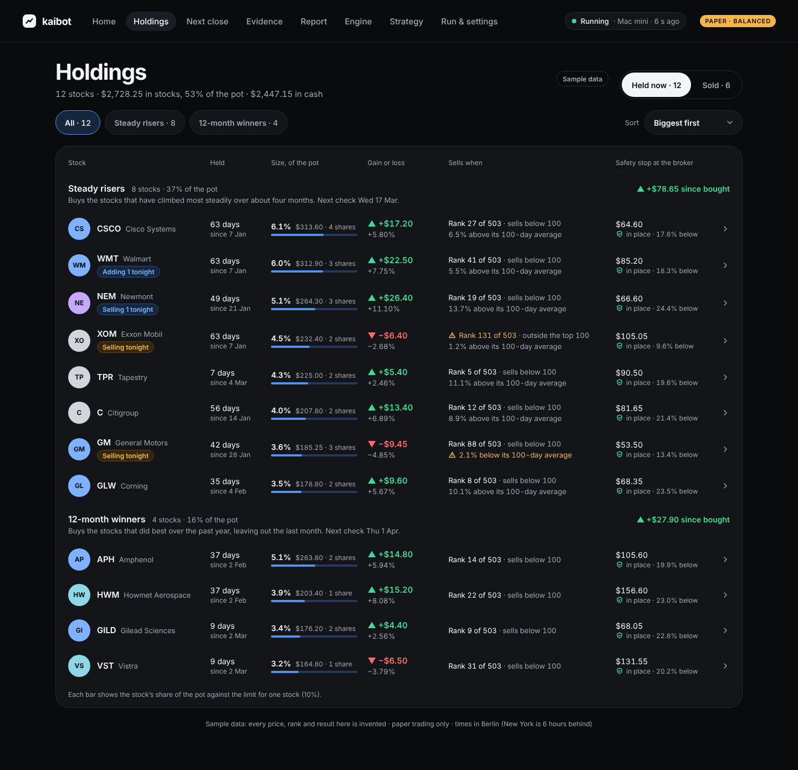 | 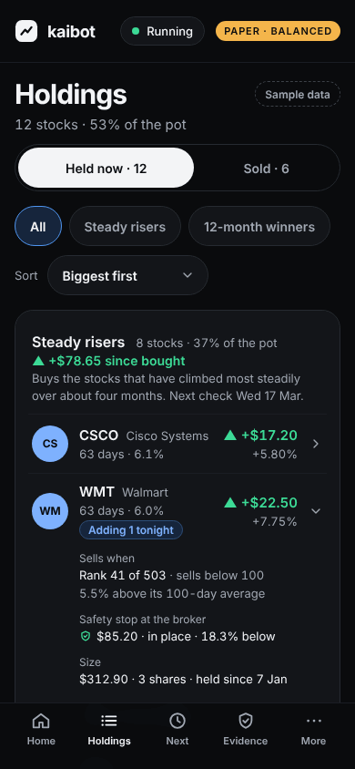 |
| 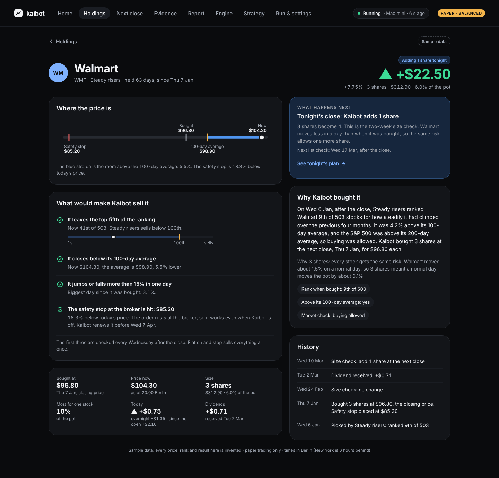 | 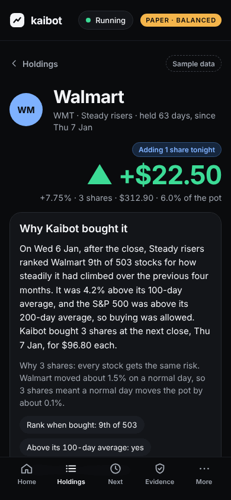 |
| 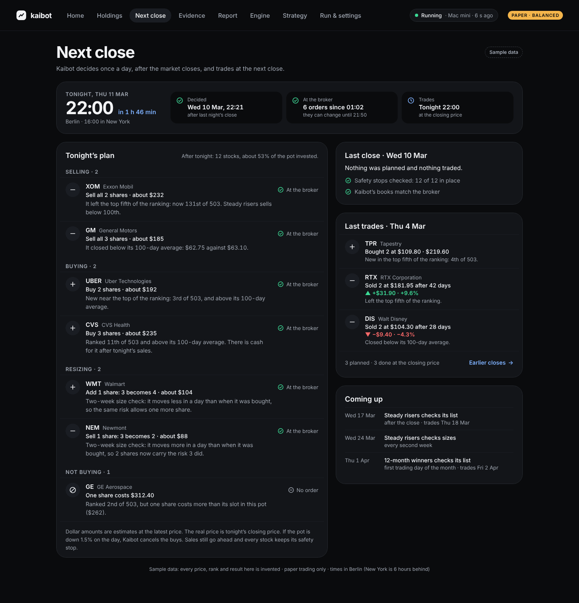 | 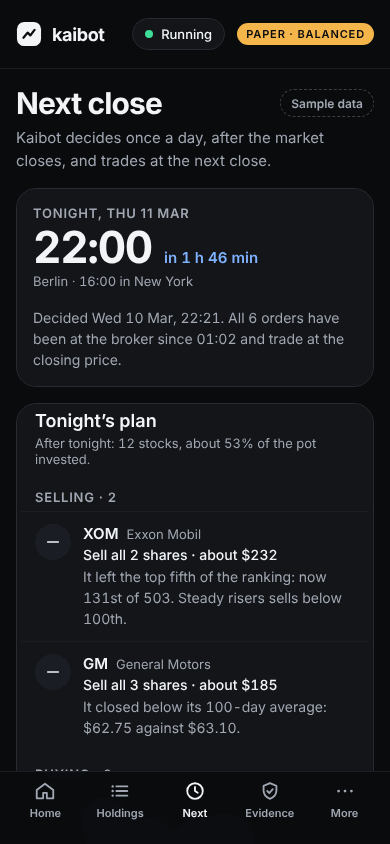 |
| 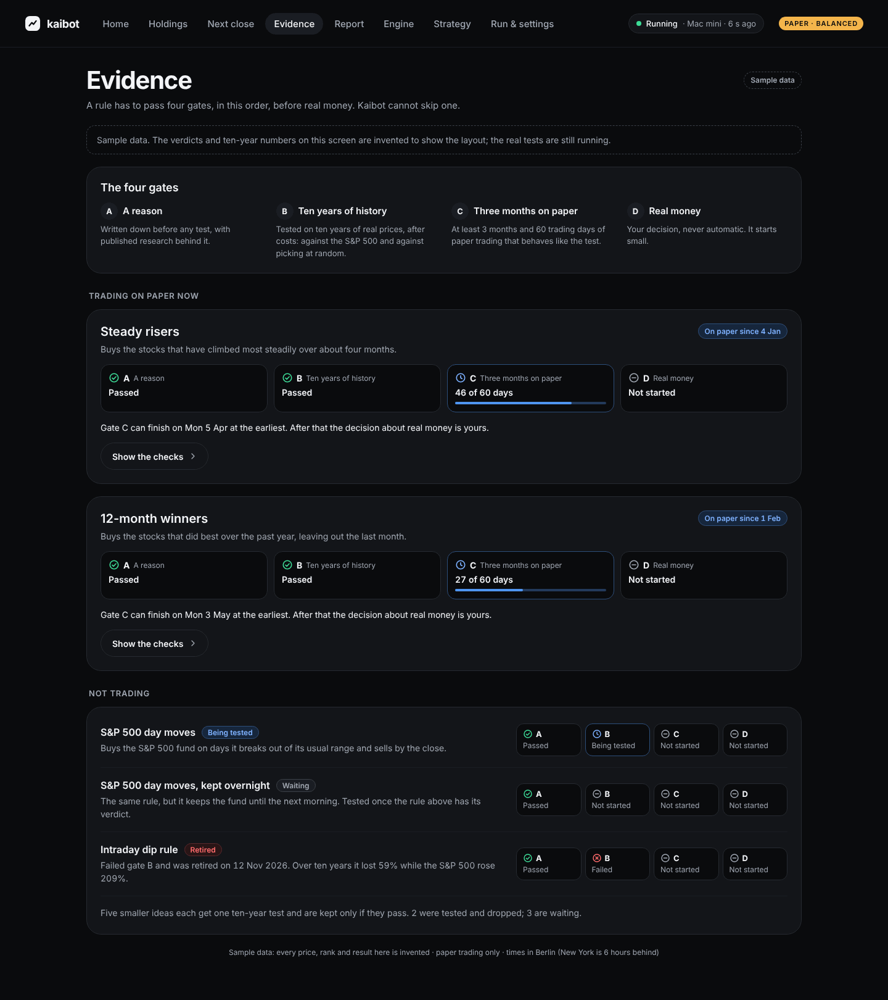 | 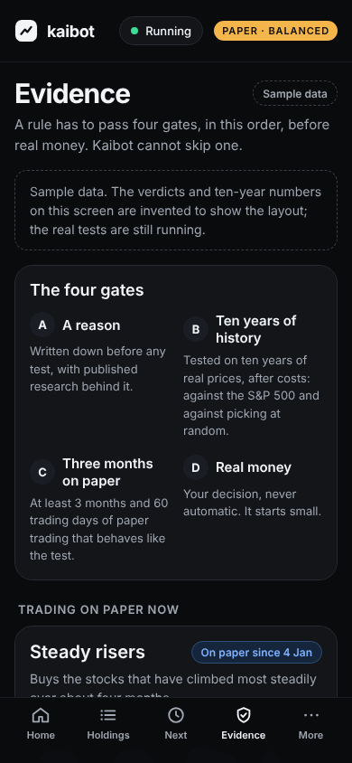 |

Home on a phone, the whole page: 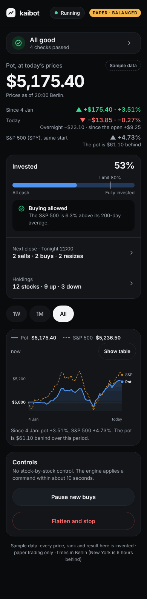

States: 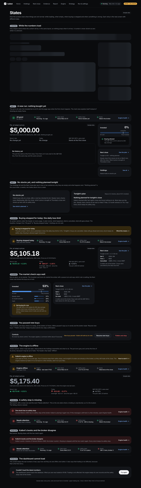

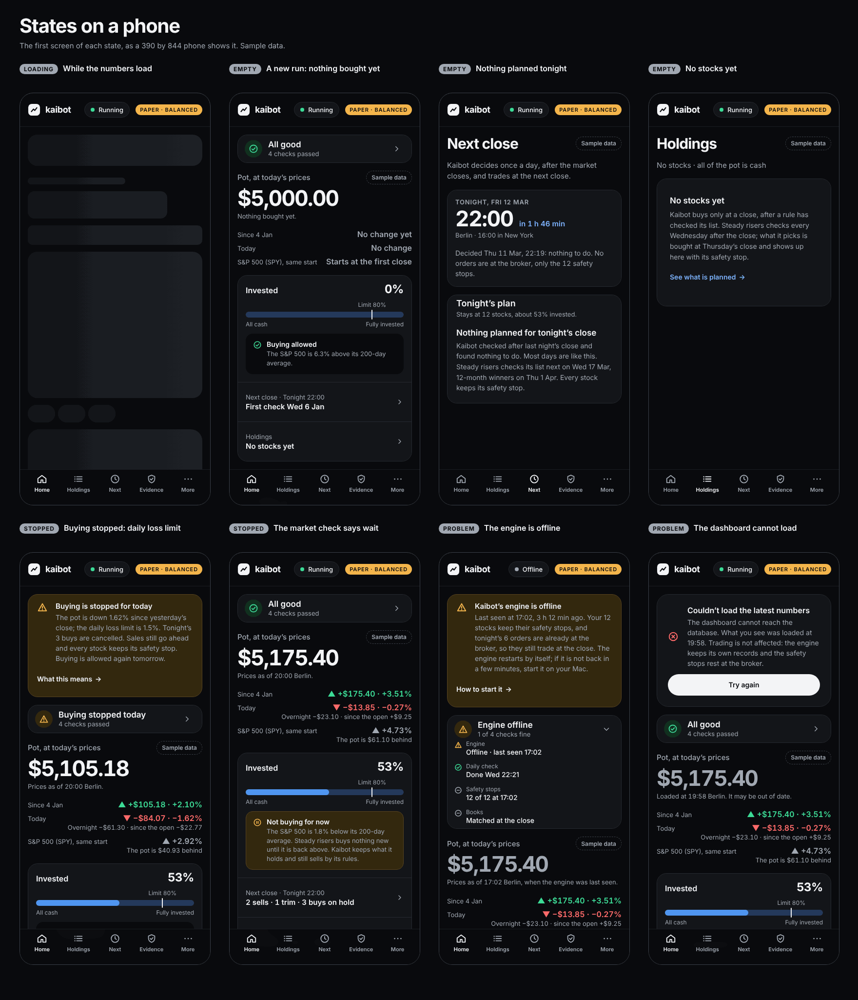

## 2. Sample data

Every price, rank, result and gate verdict is invented, and every board says "Sample data". The sample is set in the future on purpose (a paper pot of $5,000 from Mon 4 Jan 2027, seen on Thu 11 Mar 2027 at 20:14 Berlin), so nobody reads it as a track record.

`v3/gen/m7_data.py` computes every number once, so the boards agree: the twelve holdings add up to "invested", invested plus cash is the pot, gains since purchase plus results of sold stocks plus dividends equal the gain since the start, and the trading days come from a 2027 calendar with its holidays.

Two things in the sample are there to be seen, not to look good: the pot is $61.10 **behind** the S&P 500 since the start (decision 15 promises "within about two points a year", not a win), and one ranked stock is skipped because a single share costs more than its slot in a $5,000 pot.

## 3. Rebuild and check

From `docs/design/v3/gen/`:

```
python3 multiday.py                                              # writes the twelve boards
python3 preview.py --shots shots_m7.json --check                 # 34 pictures and the layout checks
python3 preview.py --shots shots_m7.json --kept --small --out ../preview/m7   # refresh the pictures above
```

`multiday.py` imports `m7_data.py` (numbers), `m7_ui.py` (nav, tab bar, CSS, icons, chart) and one module per screen. It does not import the older generators, so no existing board is rewritten.

`preview.py` is new and works for every v3 board. It opens a board in headless Chrome with `preview_support.js`, a small stand-in for the canvas runtime, and checks: sideways overflow, clipped text, text that spills out of its card, overlapping text, chart labels outside the chart, pointer targets, text contrast, gain or loss colour without a sign, and bindings without a value. It needs Playwright for Python and a Chrome on the machine. It is not the real viewer: a board that passes here still has to be looked at on the canvas.

Result on this branch: 34 pictures (twelve boards as they open, eleven after a click, six at in-between widths from 320 to 1024 px), 0 findings.

## 4. Data check against decision 15

The rule was: show nothing the engine will not have. "Ledger" and the other names are the parts in section 3 of decision 15.

Everything on the boards comes from one of those parts. Six items are not in the `Ledger` row itself: the engine computes them, but somebody has to keep them and hand them to the dashboard. They belong in the contract that Backend-quant writes in S77, and each has a fallback if it is not kept.

| On screen | Needs | Where the engine has it | For the S77 contract |
|---|---|---|---|
| Engine: "Running · 6 s ago" | heartbeat | exists today | nothing new |
| Daily check: "Done Wed 22:21" | when the after-close job finished | `Clock` and runner; S81 pings when the daily job finishes | **1.** the finish time of the last daily job |
| Safety stops: "12 of 12 in place" | per holding, whether its protective order rests at the broker | `OrderManager` (standalone protective stops); S80 verifies them | **2.** stops in place, out of how many, and which is missing |
| Books: "Match the broker" | the last comparison of cash and positions with the broker | `Ledger` (S77), gate C | the result and its time |
| Pot at today's prices, with a time | cash plus every position at its latest price | `Ledger` (daily value) and `MarketData` (latest prices) | **3.** a value during the day with its time. Fallback: the value at the last close, labelled "at the last close" |
| Since the start | start value, value now | `Ledger` | nothing new |
| Today, with "overnight" and "since the open" | yesterday's closing value, today's opening prices, value now | `Ledger` and `MarketData` (daily bars) | **4.** the value at today's open. Fallback: the total for today only, which already contains the overnight part |
| S&P 500, same start; the second chart line | SPY with dividends since the run started | `MarketData` (S84), as the chart uses today | nothing new |
| Invested %, by rule, cash | positions per rule and stock, their value | `Ledger` (positions per strategy and symbol) | nothing new |
| The limit mark | the limit in force | `PortfolioBuilder` limits; level and owner settings | the limit in force (value open, see section 7) |
| Market check: above or below the 200-day average, by how much, for which rule | SPY's close and its 200-day average; which rules use the check | `PortfolioBuilder` (index trend filter), `MarketData`, the rule's declaration | the state per rule and the distance in % |
| Next close: orders, shares, about how many dollars, state | the difference between target and held, and each order's state | `PortfolioBuilder` targets, `OrderManager` (intent written first, order states) | planned orders with their state |
| The reason on each order | why the target changed | the rule's own exit and entry rules; skipped names are "skipped and logged" | **5.** a reason code with its numbers per planned order (rank and cut-off, price and average, size check, unaffordable) |
| Holdings: days held, share, gain or loss, rule | fills, positions, cost, value | `Ledger` and its journal | nothing new |
| Holdings: "Rank 41 of 503 · sells below 100", "5.5% above its 100-day average" | per holding, each sell condition of its rule with today's reading | `Strategy` ("owns its exit rules"), `MarketData` | **6.** per holding: each sell condition, its reading and its threshold, as of the rule's last check. Fallback: the conditions as text without readings |
| Holdings: safety stop price and state | the protective order | `OrderManager`, `Broker.open_orders` | part of item 2 |
| Tags "Selling tonight", "Adding 1 tonight" | planned orders | as "Next close" | nothing new |
| One holding: why it was bought | what the rule saw when it decided | the decision record (today's `features` on each trade) | part of item 5: keep the inputs with the decision |
| One holding: history, dividends | fills, resizes, dividends | `Ledger` journal (dividends and splits are booked) | nothing new |
| Sold: result, days, reason | closed positions and why they were sold | `Ledger` journal, the rule's exit reason | nothing new |
| Next close: decided, sent, cut-off, next checks | when the job ran, when orders went out, each rule's schedule | `Clock`, `ExecutionPolicy` (orders before 15:50 New York, may queue from 19:00 the evening before), `Strategy.schedule` | the three times |
| Evidence: gates A to D and their checks | the gate report | gate v2 report (S86), the pre-registration files, the incubation plan (S93) | the report as it is, per rule |

Deliberately **not** shown, because the engine may not have it or the dashboard does not get it today:

- a price chart per stock (the dashboard has no price history; the holding view uses four numbers instead: stop, price paid, 100-day average, price now);
- the next earnings date of a holding (decision 15 leaves earnings to each rule's test);
- a forecast, a target price or a "probability" of anything;
- a per-stock line of its value over time.

## 5. Words on the screens

No engine or finance jargon on a screen. What the decision calls one thing, the screen calls another:

| In decision 15 | On the screen |
|---|---|
| sleeve, strategy | rule ("Steady risers", "12-month winners") |
| mark-to-market equity | the pot, at today's prices |
| gross exposure, exposure dial | Invested, from "All cash" to "Fully invested" |
| exposure cap | Limit |
| index trend filter, SPY above its 200-day SMA | market check: "The S&P 500 is 6.3% above its 200-day average" |
| closing auction, `cls` order | the close, the closing price |
| protective GTC stop | safety stop at the broker |
| volatility sizing, ATR | "every stock gets the same risk"; "moved about 1.5% on a normal day" |
| top 20% of the ranking | the top fifth of the ranking |
| resize | size check, "3 becomes 4" |
| halt, daily loss stop | "Buying is stopped for today", daily loss limit |
| reconciliation | Kaibot's books match the broker |
| pre-registration | "written down before the first test" |
| ten-year test, CAGR, max drawdown | ten years of history; "grew 12.4% a year"; "worst fall 21%" |
| matched random entries, 90th percentile | "beat 93 of 100 portfolios picked at random" |
| paper incubation | three months on paper |
| benchmark | S&P 500 (SPY), same start |

Two terms stay because they are exact and the brief uses them: "200-day average" and "100-day average". "Flatten and stop" keeps its name because the control exists.

## 6. Accessibility pass

Checked on the twelve boards with `preview.py` and by reading every picture. Standard: WCAG 2.2 level AA, plus the v3 rule of 44 px touch targets.

| Check | Result |
|---|---|
| Text contrast (1.4.3) | Pass. Lowest pair on any board: secondary text on the amber banner, 6.04:1 (needs 4.5). Secondary text on a card is 7.63:1, gain green 10.34:1, loss red 6.59:1, amber 10.16:1, links 8.45:1. The third text colour of the system (#7E8693) is not used: it fails on tinted cards. |
| Contrast of graphics (1.4.11) | Pass. Pot line 6.0:1 and S&P 500 line 5.9:1 on the card; bar fill against its track 3.8:1; limit mark 10.5:1; status icons 6.6:1 or more. The bar's track is quiet on purpose (1.6:1), so both ends are labelled in words. Grid lines are background, not information; the start value is also printed on the axis in bold. |
| Colour is never alone (1.4.1) | Pass. Every gain or loss has an arrow and a sign (automatic check, 0 findings). The S&P 500 line is dashed and labelled at its end. Each status has its own icon shape (tick in a circle, triangle, cross in a circle, pause, clock, dash) and a word. A sell condition that is met has a warning sign and says so in words. Chart colours pass the dataviz validator for colour-blind separation. |
| Touch and pointer targets (2.5.8) | Pass. On the phone boards every control is at least 44 by 44 px, also at 320 px width. On desktop the smallest are the top nav links (35 px high, from the shared shell) and the range chips (36 px), above the 24 px minimum. |
| No sideways scroll at 320 px (1.4.10) | Pass for Home and Holdings at 320 px; all screens checked at 800, 900 and 1024 px. Under 1180 px the holdings table becomes rows that open in place. |
| Keyboard | Every control is a link, a button or a select, in reading order, with the shell's 2 px focus ring. The chart takes focus; left and right arrows read a day, Escape leaves. |
| Names and roles | One h1 per page. Cards are labelled sections. The invested bar is a meter with a text value. Banners are `status`, or `alert` when a holding is unprotected. Holdings cells carry hidden labels ("Held", "of the pot", "Safety stop"). Stock badges are decoration and hidden from screen readers. The chart has a spoken summary and a table view. |
| Motion | All motion comes from the shell and stops under "reduce motion". Checked both ways: the settled picture is the same. |
| Text size | Body 13 to 15 px. Smallest: 11 px on tab labels, axis labels and the PAPER pill (from the shell). |
| Zoom | At 200% in a 1440 px window the pages take the phone layout. |

Not checked, and still to do before S90 is called done: a run with a real screen reader; the boards in the real canvas viewer; text-only zoom at 200%. For Frontend: "Held now / Sold" is drawn as tabs, so it needs arrow-key behaviour between the tabs, or it should become two toggle buttons.

Seen on existing boards while testing the tool, not changed here (facts for Product):

- Home: "See the report" and "All trades" are links 16 px high.
- Strategy on a phone: chips and pills of 32 to 38 px; "Exclude a stock" is 16 px high; the small grey text on a selected card is 4.15:1.
- My lists: nothing above the 44 px line except the text fields' inner input boxes.

## 7. What is new in the design system

Built from the existing tokens. Two colour values are new: the bar track `#243A5C` (chosen so the fill stands 3.8:1 against it) and a light grey badge tint `#D0D5DD`.

- **Status strip**: a headline with an icon over four checks. On a phone the checks fold while all is well and open when one fails.
- **Alarm banner**: amber or red tint, icon, headline, one or two sentences, one link.
- **Bar with a limit mark**: for one share against a limit. Used for "Invested" and, small, for the size of a stock.
- **Plan row**: a neutral round icon (plus, minus, skip), the stock, what happens, why, the order's state. Buying and selling are not coloured green and red: neither is good or bad.
- **Gate step**: icon, letter, a word, and a thin progress line while it runs.
- **Price bar** for one holding and a **rank bar** with a cut-off mark.
- **Tag**: "Selling tonight", "Adding 1 tonight".
- **Phone tab bar** with four tabs and "More".
- **Stock badges** on these boards use blue, violet, teal and light grey only. Green, amber and red carry meaning here, so no badge wears them.
- **"Sample data" pill**: boards only, not for the app.

## 8. Open decisions and questions

Listed with their sample values in the debate note: the limit on the invested share and the run loss limit per level, the most one stock may be, how far the safety stop sits, the paper pot size, whether the pot is priced during the day, and the names of the rules. The six questions for the stakeholder are at the end of the same note.
