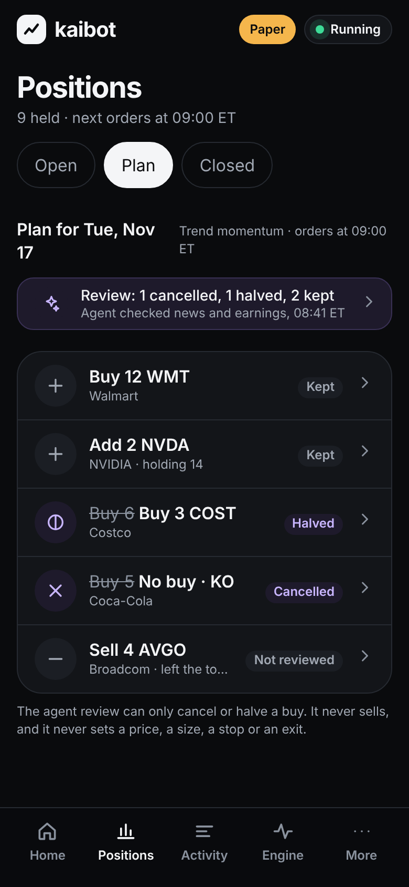
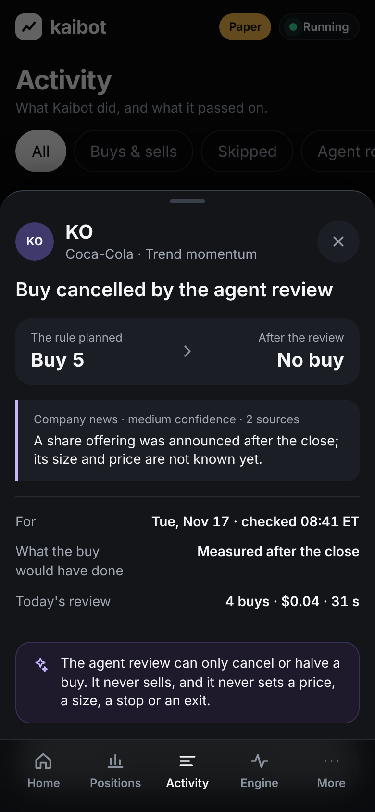

# Pre-open agent review on the dashboard (v4)

Issue #215, for #131 (M7·S91). Date: 16 Nov 2026. **Status: proposal.** Needs the stakeholder's design approval (through
Product) before Frontend builds it. The review itself stays **off** until the stakeholder switches it on.

Written in the v4 language (`mobile_first_v4.md`), as Product asked on 16 Nov 2026, not as v3 canvas boards. That replaces
the issue's "boards in `docs/design/v3/`" and "v3 tokens unchanged" criteria. The mockups use the v4 tokens plus one
existing v3 colour, the agent violet (`--ai`).

## What the review does, in one paragraph

After the close, the daily rule (today: Trend momentum, on paper) plans the next session's orders. Before those orders go
in at 09:00 ET, the agent review looks at each **buy** (a new stock or a top-up) for events the rule cannot see: company
news, earnings soon, a corporate action, bad data. Per buy it answers **keep**, **halve** or **cancel**. Sales and holds
are never shown to it and never changed. If it does not answer properly, in time and within budget, **every buy of that
session is held back** (fail closed); sales go ahead. Source: `src/kaibot/agents/preopen.py`.

## Where it shows

No new navigation item. It sits on three existing v4 surfaces and one existing status row.

| Surface | What shows | Mockup |
|---|---|---|
| **Positions › Plan** (a third chip beside Open and Closed) | The next session's plan, one row per order. Each buy carries the review's word: *Kept*, *Halved*, *Cancelled*. A halved or cancelled row shows the rule's order struck through, then what is left. Sales show *Not reviewed*. One status row above the list sums it up; one caption under it says what the agent can and cannot do. | `plan.png`, `desktop.png` |
| **Activity** | One row per halve or cancel, at the review's time, in the existing "Agent room" filter too. Kept buys get no row of their own; they show up as the buy itself at 09:30. | `activity.png` |
| **Activity sheet** (tap a review row) | The rule's order against what is left, the agent's reason with its flag, confidence and number of sources, the session and time, the whole review's cost and time, and the "can only cancel or halve" label. | `sheet.png` |
| **Home status rows** | Only when the review held back every buy (no answer, or the daily AI budget used up): one amber row. Nothing on Home while it is off, waiting or done. | `home-failed.png` |

Why Positions › Plan and not a page of its own: the M7 boards put the next close's plan on its own page ("Next close",
board 13); v4 folded Holdings into Positions, and the plan is the answer to "what will Kaibot hold tomorrow". The chip keeps
it one tap from what is held now.

## States

All seven on one board: `states.png`.

| # | State | Contract | Plan header | Rows | Colour |
|---|---|---|---|---|---|
| 1 | **Off (default)** | `status = "off"`: plan unchanged, nothing called | No review row. Caption: "Agent review is off. The rule's plan goes ahead as it is." | No tags | None |
| 2 | **Waiting** | No outcome yet for the session (derived, see question 2) | "Agent review runs before 09:00 ET · 4 buys wait for it. Sales go ahead." | As planned, no tags | Neutral |
| 3 | **Done** | `status = "done"`, a verdict per buy | "Review: 1 cancelled, 1 halved, 2 kept" | Kept / Halved / Cancelled | Violet = the agent |
| 4 | **No answer (failed closed)** | `timeout`, `error`, `invalid` | "No new buys on Tue, Nov 17 · The agent review didn't answer in time" (or "... gave an answer Kaibot couldn't use") | Every buy: "No buy · held back: no review" | Amber |
| 5 | **Daily AI budget used up** | `budget` (daily soft cap, pre-open cap of $3.00, refused reservation, unreadable state) | "No new buys on Tue, Nov 17 · Today's AI budget is used up". The sheet names which cap. | As 4 | Amber |
| 6 | **Monthly AI budget reached** | `no_entries` | "No new buys: monthly AI budget reached · Holds and sales go ahead" | As 4 | Red, to match the existing `llm_budget` halt ("Monthly LLM budget reached: no new entries"), which also stops intraday entries |
| 7 | **Nothing to review** | `done` with no candidates | No review row. Caption: "No buys to review." | Sales only | None |

**A correction to the issue.** #215 lists "review timed out or failed closed (no change to the list)". The contract does the
opposite: a failed review **vetoes every buy** of that session (`ReviewOutcome.multiplier` returns 0 for any status but
`off` and `done`). The design follows the code. The screens say plainly that no new buys go in and that sales go ahead.

## Honesty rules for this feature

- The label **"The agent review can only cancel or halve a buy. It never sells, and it never sets a price, a size, a stop
  or an exit."** shows under the plan, in every review sheet and on desktop beside the table. It is the rule in
  `preopen.apply()` and in the forced tool's schema, said in plain words.
- A cancel or a halve is **not coloured as a loss**. It is violet (the agent), with its own icon (cross, half circle) and
  a word, so colour is never alone.
- A failed review is amber, not hidden and not red: it is the system being careful, not a limit breach. The monthly cap
  stays red because it is an existing halt.
- The agent's reason is model text. It is shown as a quote, as plain text, with the flag the contract names
  (`company_news`, `earnings_soon`, `corporate_action`, `data_issue`, `none`, `unknown`) in plain words beside it.
- "What the buy would have done" is the counterfactual. It says "Measured after the close" until a number exists. It is
  never estimated on the dashboard.
- Paper and the experiment label stay on every screen, as everywhere in v4.

## Words

| In the contract | On the screen |
|---|---|
| pre-open review, room | Agent review |
| allow / downgrade / veto | Kept / Halved / Cancelled |
| candidate, increase | a buy (new stock), an add (top-up of a holding) |
| fail closed (timeout, error, invalid) | "No new buys on <day>: the agent review didn't answer in time" |
| `budget`, `rules_only`, `limits.preopen.daily_usd` | "Today's AI budget is used up" (the sheet names the cap) |
| `no_entries` | "Monthly AI budget reached" |
| flag `earnings_soon` | Earnings soon |
| confidence `medium` | medium confidence |
| arms: current / rules / reviewed | "The rule planned: Buy 5" → "After the review: No buy" |

## Fields used, and what is missing

Everything on the mockups comes from `ReviewOutcome.row()` and `PreopenVerdicts` in `preopen.py` / `agents/contracts.py`:

| On screen | Field |
|---|---|
| Kept / Halved / Cancelled | `verdicts[candidate_id]` |
| "Buy 5 → No buy", "Buy 6 → Buy 3" | `arms[candidate_id].current`, `.rules`, `.reviewed` |
| New buy or add | `arms.current` is 0 or above 0 (also `ReviewCandidate.kind`) |
| Flag, confidence, reason, number of sources | `answer.verdicts[].flag`, `.confidence`, `.reason`, `len(.evidence_ids)` |
| State and its reason | `status`, `error` |
| "$0.04 · 31 s" for the whole review | `cost_usd`, `latency_ms` (per session, not per buy; the sheet says "Today's review") |
| Session | `session` |

**Questions for Agents-AI and Backend-quant** (not assumed; the mockups use sample values):

1. **Where is the outcome kept, and how does the dashboard read it?** `ReviewOutcome.row()` is not written to any table
   or heartbeat yet, and the engine does not call `review()` yet. Proposal: one row per session in a table read by a new
   `kb_preopen(p_run, p_session)` RPC, contract written by Agents-AI before either side builds.
2. **"Waiting" has no status.** The dashboard can only infer it (plan known, no outcome yet). Should the engine write a
   `pending` marker with the planned time, or is "no row yet before 09:00 ET" enough?
3. **The review time.** The row has `latency_ms` but no timestamp; "checked 08:41 ET" needs one.
4. **Company name and rule per buy.** `candidate_id` is `"<strategy>:<symbol>"`, which gives both codes; names come from
   the dashboard's own tables. Fine as is, unless Agents-AI prefers to store `ReviewCandidate` too (kind, rank, reasons,
   shown features), which would let the sheet say "ranked 3 of 40".
5. **What `evidence_ids` point to.** The pre-open data block has no news pack, unlike the intraday room. Are the ids news
   item ids the dashboard can resolve to headlines, or feature names? Until that is known the sheet shows only the count.
6. **The counterfactual.** `evalset/preopen.py` says both arms are replayed through SimBroker. Where does that result land,
   and when, so "What the buy would have done" can show a number?
7. **Planned orders for the plan list.** `lib/book.ts` notes that the next close's planned orders are not in any contract
   yet. The plan chip needs them with or without the review (sales, buys, adds; share counts). Prices and dollar amounts
   are left out of these mockups for the same reason.
8. **Which cap was hit.** `error` carries it as text ("pre-open daily cap reached ($3.0100 of $3.00)"). A code
   (`daily_soft`, `preopen_daily`, `reservation`, `unreadable`, `monthly`) would let the sheet word it without parsing text.

## Accessibility

Checked on the six mockups with the audit script (`audit_2026-11-16/tools/metrics.js`) and axe-core 4.10 (WCAG 2 A/AA,
2.1 AA, 2.2 AA): **0 violations, no page wider than the screen, no tap target under 44 px, no text under 12 px.**

| Check | Note |
|---|---|
| Contrast | Violet text `#C9B6FF`: 9.39:1 on its tint `#1E1A2B`, 10.11:1 on the surface; secondary text on the tint 7.08:1. Struck-through old order uses `--text-3` `#8A929E`, 5.82:1 on the surface, and is never the only carrier of meaning: the new order follows it in full. |
| Colour alone | Every verdict has a word and an icon shape (plus, half circle, cross, minus). States 4 to 6 have a word headline. |
| Touch | Rows 64 px, status rows 48 px or more, sheet close 44 px, desktop row buttons 44 by 44. |
| Screen readers | Struck-through text needs a spoken form: "Rule planned buy 5, after review no buy". The sheet is a modal dialog named after the stock and the verdict. Review rows in Activity read "Review cancelled KO, company news since the close, 08:41". |
| Zoom | At 200% the desktop page takes the phone layout (v4 breakpoint at 760 px). |
| Motion | None new. The sheet uses the v4 sheet motion and stops under reduced motion. |

Not checked: a real screen reader, Safari, a real phone.

## Mockups

Static HTML, generated by `mockups/v4/preopen/gen.py` (imports the v4 generator's tokens and rows). Sample data: the plan
for Tue 17 Nov 2026. Screenshots and checks: `python mockups/v4/preopen/shoot.py <axe.min.js>`.

| Screen | File | Words in the first screen |
|---|---|---|
| Positions › Plan, review done (phone) | `mockups/v4/preopen/plan.png` | 106 |
| Activity with two review rows (phone) | `mockups/v4/preopen/activity.png` | 79 |
| Review sheet, a cancelled buy (phone) | `mockups/v4/preopen/sheet.png` | 176, sheet over the list |
| The seven states (phone, one board) | `mockups/v4/preopen/states.png` | board |
| Home when the review held back every buy (phone) | `mockups/v4/preopen/home-failed.png` | 49 |
| Positions with plan and detail (desktop 1440) | `mockups/v4/preopen/desktop.png` | 237 |

 

## For Frontend, once approved

1. Plan chip on Positions with the plan rows (needs question 7), review tags and status row.
2. Review rows in Activity and the review sheet, behind the "Agent room" filter as well.
3. Home amber row for states 4 and 5; state 6 already arrives as the `llm_budget` halt.
4. Every state renders with the review off by default, so state 1 is what the stakeholder sees until switching it on.
